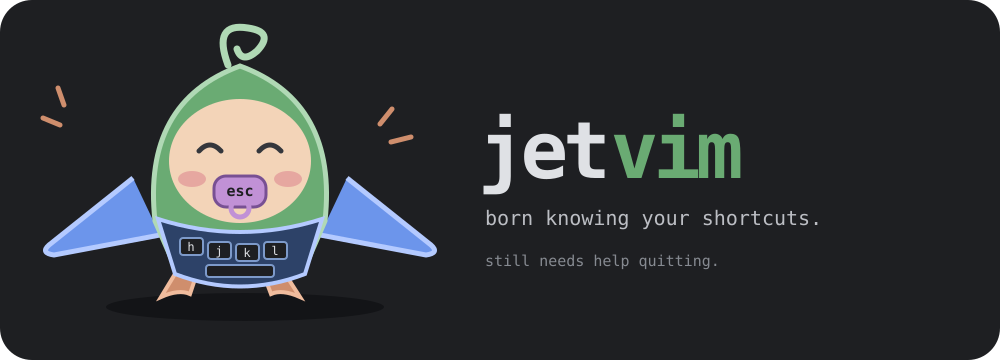

# Jetvim

if jetbrains and vim had a baby!



```bash
curl -fsSL https://raw.githubusercontent.com/amirkabiri/jetvim/main/install.sh | bash
```

[Usage, settings and terminal support](docs/guide.md)
